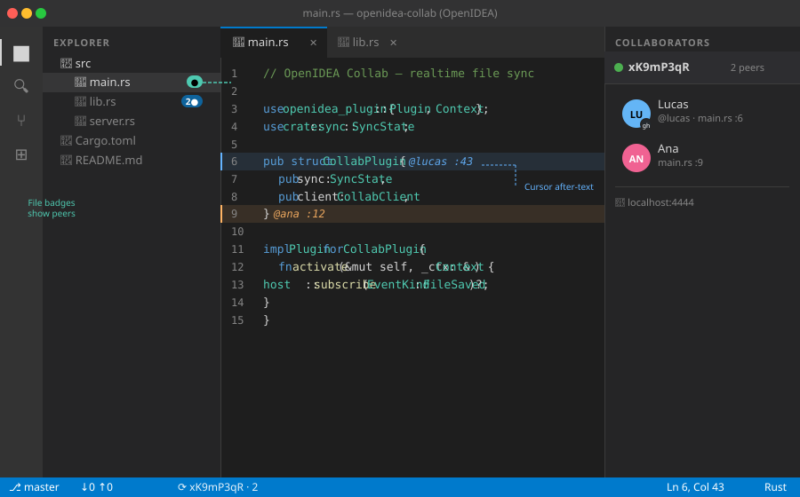

# OpenIDEA Collab

Real-time collaborative editing for [OpenIDEA](https://github.com/l0ng-ai/openidea) — sync files between developers (and AI agents) over HTTP long-poll without WebSockets.



## Features

- **Room-based sessions** — create or join a room with a simple ID
- **File sync** — changes are pushed to all room members within ~500 ms
- **Live cursor decorations** — see teammates' cursor positions as inline after-text annotations
- **GitHub avatars** — connect a GitHub username for real profile photos in the panel
- **File-tree badges** — open files get a `●` badge showing how many peers have them open
- **Status bar** — room ID and peer count visible at the bottom of the editor at all times
- **HTML presence panel** — animated sidebar showing all peers with avatars, files, and cursor positions
- **Remote server** — configure any HTTP URL with *Collab: Set Server URL* (ngrok, Cloudflare Tunnel, etc.)
- **3-way merge** — conflict detection; 409 returned on unresolvable conflicts
- **AI-agent ready** — collab-server exposes a plain REST API any agent can call

## Architecture

```
┌────────────────┐    HTTP long-poll     ┌──────────────────┐
│  OpenIDEA IDE  │◄──────────────────────│  collab-server   │
│  (plugin WASM) │──────────────────────►│  (axum / Tokio)  │
└────────────────┘   POST /rooms/:id/…   └──────────────────┘
```

| Component | Description |
|-----------|-------------|
| `openidea-collab/` | Plugin (Rust → `wasm32-wasip2`) — commands, sync loop, presence panel |
| `collab-server/` | Standalone HTTP server — rooms, events, presence, file store |
| `scripts/` | Dev helpers (`dev-server.sh`, `dev-plugin.sh`) |
| `.github/workflows/release.yml` | CI: build → pack → create GitHub Release |

## Quick start

### 1. Run the server

```bash
# Install Rust if needed: https://rustup.rs
cargo run --manifest-path collab-server/Cargo.toml
# Server listens on http://localhost:4444
```

Environment variables:

| Variable | Default | Description |
|----------|---------|-------------|
| `COLLAB_PORT` | `4444` | Listening port |
| `RUST_LOG` | `info` | Log level |

### 2. Build and install the plugin

```bash
# Install the OpenIDEA plugin CLI
cargo install --locked --git https://github.com/l0ng-ai/openidea ide-host --bin openidea-plugin

# Build
cd openidea-collab
openidea-plugin build        # output: dist/plugin.wasm

# Install into OpenIDEA (dev link)
openidea-plugin link .
```

### 3. (Optional) Set a remote server

Run **Collab: Set Server URL** and enter your server's public URL.

> **Cross-network**: `ngrok http 4444` gives you an HTTPS URL — paste it into *Set Server URL* on both machines.

### 4. Start collaborating

1. Open the **Collaborators** panel in the right sidebar.
2. Run **Collab: Create Room** — enter your name and (optionally) GitHub username.
3. Share the Room ID and server URL with your collaborator.
4. On the other machine: run **Collab: Join Room**, enter the Room ID, name, and GitHub username.

## Commands

| Command | Description |
|---------|-------------|
| **Collab: Create Room** | Create a new room, ask for name + GitHub username |
| **Collab: Join Room** | Join an existing room by ID |
| **Collab: Leave Room** | Leave the current room |
| **Collab: Set Server URL** | Configure the collab-server endpoint |

## REST API (collab-server)

| Method | Path | Description |
|--------|------|-------------|
| `POST` | `/rooms` | Create room → `{"room_id": "…"}` |
| `POST` | `/rooms/:id/join` | Join room, get `member_id` |
| `GET` | `/rooms/:id/members` | List present members |
| `POST` | `/rooms/:id/members/:uid/presence` | Update current file |
| `GET` | `/rooms/:id/files/:path` | Get latest file text + version |
| `POST` | `/rooms/:id/files/:path` | Push file update (conflict → 409) |
| `GET` | `/rooms/:id/events?cursor=N` | Long-poll for new events (holds 5 s) |

All endpoints return JSON. The `events` endpoint holds the connection open until an event arrives or the timeout expires.

## Install

### One-line installer (Linux · macOS)

```bash
curl -fsSL https://raw.githubusercontent.com/SorPuti/openidea-collab/master/install.sh | bash
```

The script:
- Detects your OS (Fedora, Ubuntu/Debian, Arch, macOS)
- Installs Rust via `rustup` if needed
- Builds and installs `collab-server` to `~/.local/bin/`
- Registers a **systemd user service** (Linux) or **launchd agent** (macOS) so the server starts automatically on login
- Downloads the latest `.oiplugin` to `~/Downloads/`
- Prints next steps

> Override defaults with env vars: `COLLAB_PORT=5000 INSTALL_DIR=/usr/local/bin curl … | bash`

### From marketplace (once PR is merged)

In **OpenIDEA → Settings → Plugins → Available**, search for `openidea-collab`.

### Manual plugin install (no marketplace required)

1. Go to the [latest release](https://github.com/SorPuti/openidea-collab/releases/latest).
2. Download `sorputi.openidea-collab-X.Y.Z.oiplugin`.
3. Drag the `.oiplugin` file onto the OpenIDEA window, or use  
   **Settings → Plugins → Install from file…** and select it.

The plugin is active immediately — no IDE restart required.

## Development

```bash
# Run server with auto-reload (requires cargo-watch)
cargo watch -x 'run --manifest-path collab-server/Cargo.toml'

# Run server tests
cargo test --manifest-path collab-server/Cargo.toml

# Rebuild plugin after code changes
cd openidea-collab && openidea-plugin build
```

## Release

Tag a version to trigger the GitHub Actions release workflow:

```bash
git tag v0.2.0
git push origin v0.2.0
```

The workflow builds the plugin, packs it as `.oiplugin`, and creates a GitHub Release. Required secrets: `OPENIDEA_KEY` (PEM signing key content) and `OPENIDEA_PUBLISHER_ID` (`sorputi`).

## License

MIT — see [LICENSE](LICENSE).
