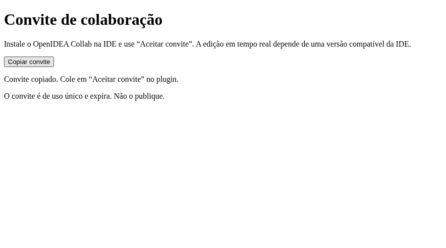

# Validation

Run `./src/tooling/check.sh`. It validates metadata/provenance tests, formatting, Clippy with warnings denied, workspace tests and the WASM build. The relay integration suite starts its own loopback listener on an OS-selected port and tests HTTP/WebSocket access without a running external service.

Package check: with the official OpenIDEA v0.1.43 `openidea-plugin` CLI available, run `./src/tooling/package-dev.sh`. This verifies the staged development package, not a publisher signature or marketplace installation.

The suites cover single-use invitations under concurrent redemption, viewer/owner roles, authenticated sender stamping, registered-document/room boundaries, revoked open sockets, oversized frames, metadata restart without credentials/content, failed metadata commits, queue overflow, malformed protocol, exact-origin invites, UTF-16/convergence, checkpoint corruption/project mismatch, chunk reordering and unsafe path policy. Plugin/SDK tests also prove activation sends no files, project changes cannot reuse a session, exact document filters are installed, local committed text reaches an outbound CRDT frame, and an inbound peer update reaches the versioned editor and produces an ACK.

## Required actual IDE acceptance

Install the candidate in three isolated OpenIDEA v0.1.43-or-newer profiles without Rust/CLI/helper. Confirm native UI, owner/editor/viewer grants, exact path isolation, project switching, safe credential lifecycle, concurrent native edits, nonfocused documents, Undo/Redo, Unicode/IME, reconnect/reclamation, checkpoint failure handling, revocation and bounded queues. Use disposable synthetic content only.

Public deployment also requires actual HTTPS/WSS certificate/proxy tests, operator admission controls, resource measurements, restart and slow-peer behavior. A localhost forwarding measurement is not a measure of internet or IDE editing latency. Platform and full-IDE tests not executed must remain marked pending.

## Measured local evidence — 2026-11-10

Environment: Linux execution workspace, Rust 1.96.0, unoptimized test-profile relay binary without debug symbols, one async worker, metadata persistence enabled. Synthetic payloads only. This measurement excludes internet, TLS proxy and real OpenIDEA editing.

```sh
cargo test --locked -p collab-server --test resource_budget -- --ignored --nocapture
```

At 16 real WebSocket connections across 4 rooms, 400 messages of 1 KiB were fanned out into 1,200 deliveries. The separate relay process had a sampled peak RSS of **7,744 KiB (about 7.6 MiB)**; fanout completion p50 **194 µs**, p95 **511 µs**, maximum **33,218 µs**. The run lasted about 0.33 s. This is a short local functional/budget check, not a soak test, a CPU benchmark, a worst-case allocation bound or a latency guarantee. Kernel socket buffers, proxy TLS, clients and IDEs are outside this process RSS.

The historical 16-connection setup above predates the current three-member room limit and is not reproducible with current limits: the old benchmark attempted four members per room and failed with HTTP 429.

On 2026-11-13, the corrected benchmark ran four rooms with three members each, 400 synthetic 1 KiB messages and 800 deliveries. On the local Linux development machine, the unoptimized relay process reached a sampled peak of 8,308 KiB RSS, with fanout completion p50 40 µs, p95 56 µs, and maximum 40,633 µs. This was one short run, with journal output discarded and no TLS proxy, internet, actual IDE or VPS measurements; it is not a capacity or latency guarantee.

The optional browser check was executed with Playwright and system Chromium:

```sh
CHROMIUM_EXECUTABLE_PATH=/usr/bin/chromium node src/tooling/tests/invitation-ui.mjs
```

It verified copying the complete synthetic invitation, clearing its fragment from the current history entry, disabling copying when no secret is present, and the absence of third-party requests. This tests the relay invitation page, not the native IDE view. Its screenshot contains no invitation secret:



On 2026-11-10 a separate live smoke check created an owner and editor through HTTPS, registered a synthetic document, negotiated `openidea-collab.v1` over two authenticated WSS connections at `collab.synthosia.com`, forwarded one bounded binary frame and revoked the owner session. It printed no credentials or content. This proves the deployed authentication/upgrade/forwarding path at that moment, not sustained reliability.

Historical local validation on 2026-11-10 covered source/release guards, formatting, Clippy with warnings denied, 37 Rust tests (plus one opt-in resource test ignored), five Python release-guard tests and the optimized `wasm32-wasip2` build. On 2026-11-12, the plugin's 8 unit/integration tests and its optimized WASM build passed against the immutable official OpenIDEA `v0.1.43` SDK commit `7c51662`; the published `openidea-plugin 0.1.43` (API 1.6.0) accepted the staged package. The resulting WASM has SHA-256 `0c540fbcfb5109a55d691bc46a01fd335d0771e86848536082eff331700c1940`. This is package validation, not a publisher signature, installed-IDE acceptance, cross-platform execution or a marketplace approval.

Remote GitHub Actions did not execute the PR job: the check annotation reports “The job was not started because your account is locked due to a billing issue.” Local results above are independent of that account-level blocker; no remote CI success is claimed.

## Isolated VPS relay benchmark — 2026-11-13

On the 512 MB Lightsail instance (2 vCPU, approximately 412 MiB available to the OS), `src/tooling/relay-load.py` launched a separate loopback relay using synthetic authorization metadata and synthetic payloads. It did not modify production sessions. Three paired 4-room/12-socket burst runs with 1 KiB messages showed p99 fanout completion around 39.5–39.7 ms before enabling TCP_NODELAY and 1.28–1.36 ms afterwards. These values include the Python load generator and are not internet or IDE latency.

The candidate with 16-room/64-socket limits was tested at 16 rooms, three members each (48 sockets):

| Synthetic workload | Duration | Delivered frames | Relay sampled peak RSS | Relay mean CPU | p95 fanout |
| --- | ---: | ---: | ---: | ---: | ---: |
| 400 × 1 KiB per room, 40 ms delay | 18.3 s | 12,800 | 9,784 KiB | 4.20% of one CPU | 4.51 ms |
| 100 × 16 KiB per room, 100 ms delay | 13.5 s | 3,200 | 10,256 KiB | 2.07% of one CPU | 33.29 ms |
| 30 × 60,000 bytes per room, 300 ms delay | 12.5 s | 960 | 11,656 KiB | not measured | 113.87 ms |

The client and relay shared the same machine; Python masking and scheduling affect timings. The relay journal was discarded during these runs, and Caddy, TLS, real networks, IDE state, mixed traffic and long-term usage were not measured. The synthetic state was prepared ahead of time, so these runs do not measure session creation, invitation, metadata fsync or abuse-rate limits. An unpaced run at 150 frames per room timed out; its cause was not established, and rate or queue protections may have contributed. This is not a no-loss claim beyond the tested paced workload. These short tests do not guarantee behavior at sustained saturation or demonstrate whole-project synchronization.
